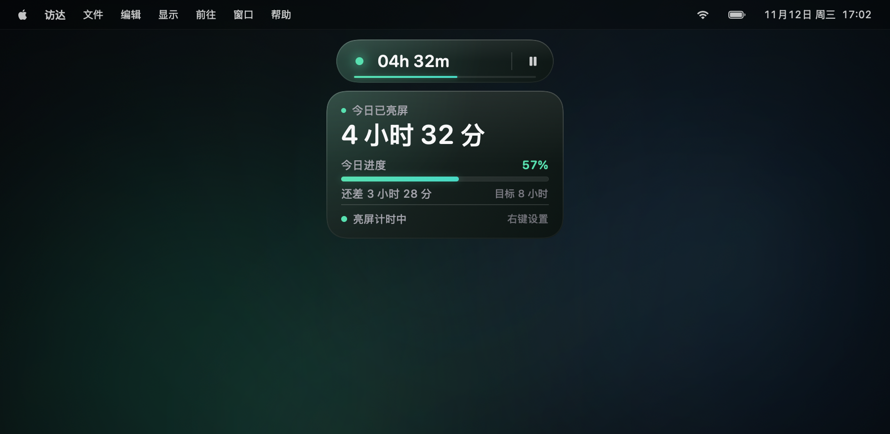
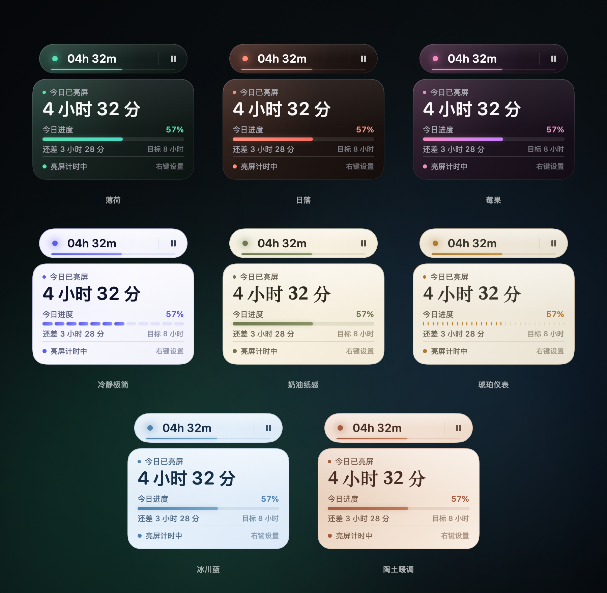
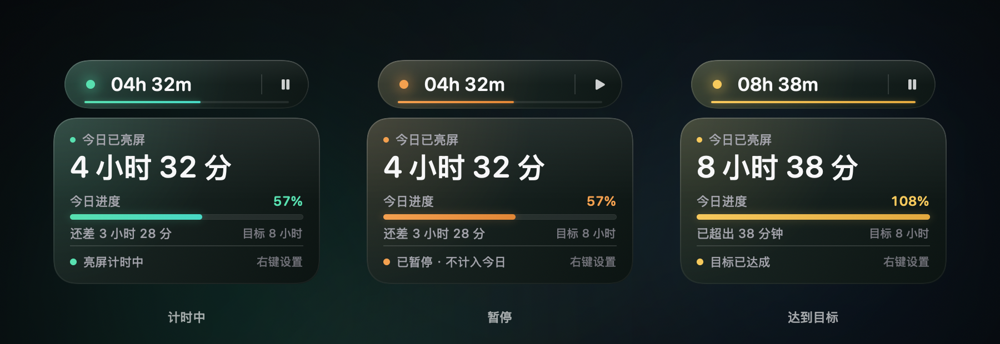
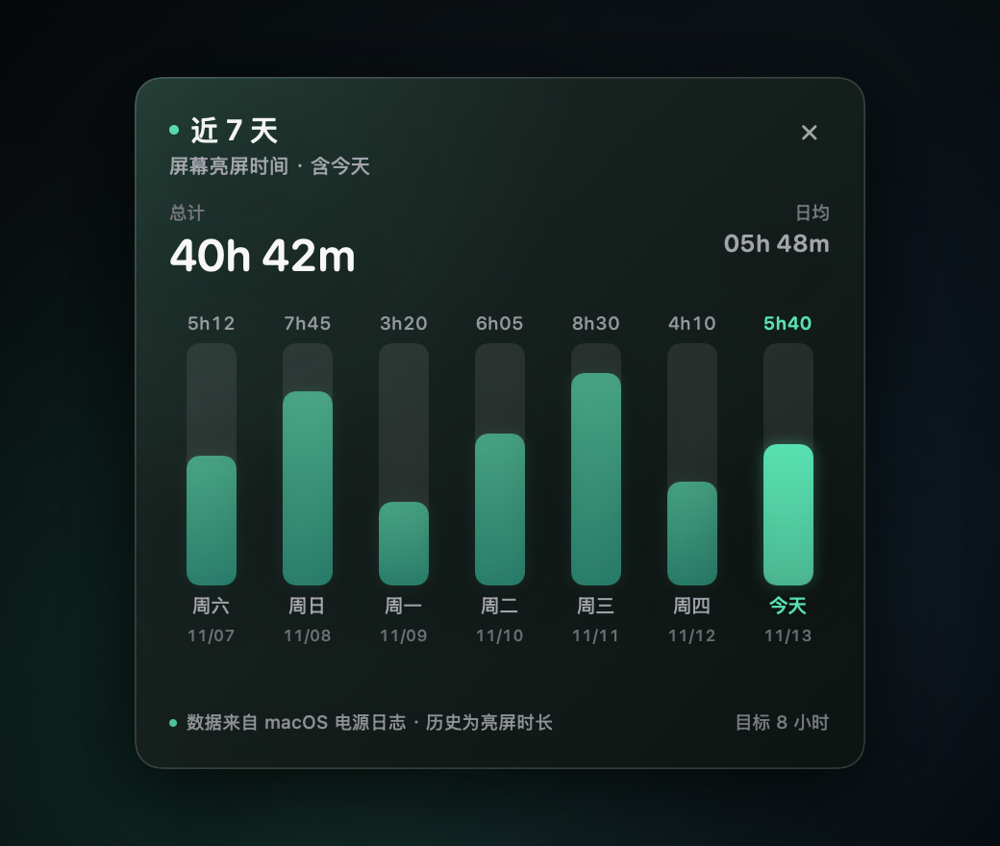
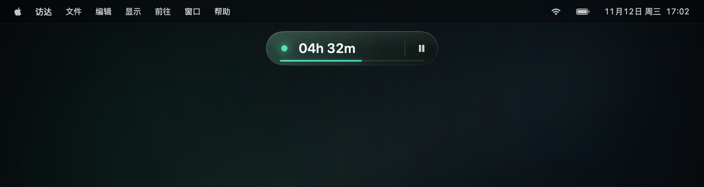

# 屏幕计时 · 桌面胶囊计时器

一个常驻 macOS 屏幕顶部的原生小组件：记录今天屏幕亮着的累计时长，并把「今天工作了多久」压缩进 220 × 44 pt 的胶囊里。折叠时只看一眼，展开后是一张以今日时长为视觉主角的目标卡片。



## 直接使用

已构建好的 App 在：

```text
screen-time-widget/build/屏幕计时.app
screen-time-widget/build/屏幕计时.zip
```

解压 `屏幕计时.zip`，把 `屏幕计时.app` 拖进「应用程序」即可。首次打开如果被 macOS 拦截，右键 App →「打开」。

启动后：

- 没有 Dock 图标，只在菜单栏出现一个计时器图标。
- 胶囊悬浮在所有窗口之上，默认位于屏幕顶部居中、菜单栏下方。
- **按住胶囊拖动**：位置会记住，下次启动仍在原处；菜单栏执行「重新居中到顶部」可复位。
- 鼠标悬停胶囊：向下平滑展开 240 × 150 pt 的今日卡片。
- 点击右侧暂停 / 播放按钮：暂停或继续计时。
- 右键胶囊：暂停、查看近 7 天使用情况、设置今日目标、切换主题、自定义文案、隐藏小组件、退出。
- 菜单栏计时器图标：显示 / 隐藏、暂停、近 7 天使用情况、目标快捷设置、主题、自定义文案、重新居中、退出。

希望开机自动运行：系统设置 → 通用 → 登录项与扩展 → 添加 `屏幕计时.app`。

## 八组主题

默认使用薄荷色；在右键菜单或菜单栏的「主题」中切换。每组主题都会同时改变强调色、深色/浅色底和细节风格，选择会保存在本机。



- **薄荷（默认）**：清透青绿，最安静、最适合常驻。
- **日落**：珊瑚橙，像傍晚收工前的一点温度。
- **莓果**：莓粉过渡到淡紫，更活泼但不刺眼。
- **冷静极简**：冷白偏淡紫的底，靛蓝强调，抽屉进度改成 12 段式。
- **奶油纸感**：奶油纸张底色，橄榄绿强调，主数字使用衬线体，安静、偏手作感。
- **琥珀仪表**：米杏底，琥珀棕强调，抽屉进度使用刻度式仪表，配衬线数字。
- **冰川蓝**：冰川浅蓝底，钢蓝强调，冷调藏青文字，像一块通透的冰面。
- **陶土暖调**：陶土杏色底，棕红强调，衬线数字和暖调边框，偏手作陶器感。

三组深色主题会改变胶囊、抽屉和近 7 天卡片的深色底色；五组浅色主题则切换为浅色表面与深色文字。暂停在浅色主题下使用更深的暖橙，达成目标使用更深的金色，保证对比度。

单独查看：[日落](docs/preview-sunset.png) · [莓果](docs/preview-berry.png) · [冷静极简](docs/preview-minimal.png) · [奶油纸感](docs/preview-cream.png) · [琥珀仪表](docs/preview-amber.png) · [冰川蓝](docs/preview-ice.png) · [陶土暖调](docs/preview-terracotta.png) · [金色完成态](docs/preview-complete.png)

## 状态与完成动画



- **计时中**：清透青绿，状态点、底部进度线、进度条和百分比统一着色。
- **暂停**：暖橙，播放按钮取代暂停按钮，抽屉状态显示「已暂停 · 不计入今日」。
- **达到目标**：金色，状态文案变为「目标已达成」。进度条会播放一次短暂的辉光与流光，胶囊底边进度线也会轻轻亮一下，然后恢复安静。
- 如果达成目标时抽屉没有展开，首次展开抽屉时补播一次进度条完成动画。
- 屏幕休眠或读取失败时使用低饱和灰，错误状态下用红色，避免打扰。

## 自定义文案

右键胶囊或菜单栏计时器图标 →「自定义文案…」：

- 主标题：抽屉里「今日已亮屏」这行，最多 16 个字
- 进度标题：进度条上方「今日进度」这行，最多 10 个字
- 留空会恢复默认；点「恢复默认」可一键还原
- 保存后立即生效，并只写入本机 `UserDefaults`

## 近 7 天使用情况

右键胶囊或菜单栏计时器图标 →「近 7 天使用情况…」，会在胶囊下方打开一个原生浮层：



- 展示包含今天在内的 7 天柱状图，今天用当前状态色高亮，其余日期使用当前主题的柔和色。
- 顶部显示 7 天总计和日均；每根柱子上方是当天时长，下方是星期与日期。
- 今天与胶囊里的计时一致（会扣除暂停），历史日期为电源日志中的原始亮屏时长。
- 浮层跟随当前主题；浅色主题下会切换为浅色卡片与深色文字。点击外部自动关闭，也可以点右上角 ×。

浅色主题效果：[冷静极简 / 奶油纸感](docs/preview-history-light.png)

## 设计细节

- **胶囊**：220 × 44 pt，全圆角，深色玻璃质感，顶部高光 + 细描边。
- **胶囊进度线**：底边一条 2 pt 的极细进度线，不悬停也能看到今日目标走到哪里。
- **布局**：状态点 → `04h 32m` → 细分隔线 → 暂停按钮。
- **可拖动**：按住胶囊任意空白处即可移动，松手后自动吸附在屏幕可见范围内并保存位置。
- **悬停抽屉**：240 × 150 pt，重新排成三层：
  - 最大视觉重点：`今日已亮屏` + `4 小时 32 分`
  - 目标层：`今日进度`、百分比、进度条、`还差 3 小时 28 分`、`目标 8 小时`
  - 状态层：当前状态与「右键设置」，字号提升到 10.5–11 pt
- **目标**：默认 8 小时；右键菜单提供 6–10 小时快捷键和自定义（0.5–24 小时）。
- **位置**：`NSPanel` + `.floating` 层级，加入所有 Space，并支持全屏应用上方显示。

折叠状态：



## 计时口径

数据来自 macOS 自带的电源管理日志：

```bash
pmset -g log
```

解析其中 `Display is turned on/off` 通知，计算今天所有亮屏区间的并集时长。

- 包含锁屏但屏幕仍亮着的时间。
- 屏幕休眠期间不计时。
- 点击暂停后，暂停区间会从今日时长中扣除；适合午休、离开工位等场景。
- 本地每秒走时，每 20 秒与 `pmset` 日志对齐一次；唤醒、切换日期后会自动刷新。
- 近 7 天视图同样从 `pmset` 日志回溯计算，含今天；不依赖云端或系统「屏幕使用时间」。
- 所有状态只写入本机 `UserDefaults`，不联网，不需要「屏幕录制」权限，也不读取具体 App 的使用情况。

## 构建

环境：macOS 15+、Swift 6.3 Command Line Tools、Apple Silicon。

```bash
cd screen-time-widget
./build.sh
```

脚本会：

1. 编译 `Sources/*.swift` 为原生 App；
2. 通过 `ImageRenderer` 生成 1024 px 图标并打包 `.icns`；
3. 生成 ad-hoc 签名；
4. 输出 `build/屏幕计时.app` 与 `build/屏幕计时.zip`。

当前机器上的 Swift 6.3.3 编译器与 CommandLineTools 自带 macOS 26 SDK 的 Swift 接口版本不一致，因此脚本优先选用 `MacOSX15.4 SDK`，部署目标为 macOS 15.0。

## 诊断

```bash
# 打印 pmset 解析结果
build/屏幕计时.app/Contents/MacOS/ScreenTimer --dump

# 重新渲染预览图、状态/主题对比图、近 7 天卡片和图标
build/屏幕计时.app/Contents/MacOS/ScreenTimer --snapshot build/previews
```

## 文件结构

```text
screen-time-widget/
├── Sources/
│   ├── ScreenTimerMain.swift   # 入口、--dump / --snapshot
│   ├── AppDelegate.swift       # 菜单栏、状态项、目标与主题菜单
│   ├── ScreenTimeModel.swift   # 计时、暂停、目标、主题、完成事件、跨日刷新
│   ├── PowerLog.swift          # pmset 日志解析
│   ├── WidgetWindow.swift      # 顶部悬浮 NSPanel、拖动、悬停展开
│   ├── WidgetView.swift        # 胶囊、进度线、抽屉、完成动画
│   ├── HistoryView.swift       # 近 7 天柱状图浮层
│   ├── SnapshotRenderer.swift  # 预览图 / 状态与主题对比图 / App 图标
│   └── Theme.swift             # 主题、状态色、时长格式
├── Resources/Info.plist
├── docs/                       # 预览图
├── build.sh
└── README.md
```

## 说明

- 这是「屏幕亮着多久」的计时器，不是 macOS「屏幕使用时间」的替代品，也不区分前台 App。
- 只构建了 arm64 版本，适配这台 Apple Silicon Mac。
- 若要长期使用，建议把 App 放进「应用程序」并加入登录项；当前目录里的构建产物可以直接运行。
